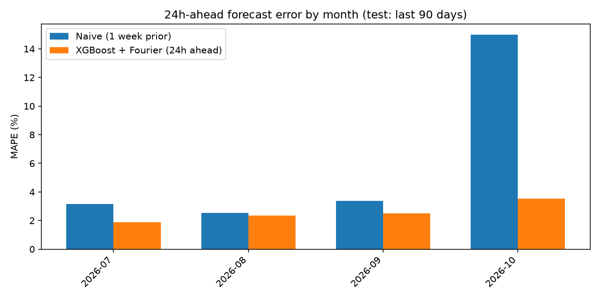
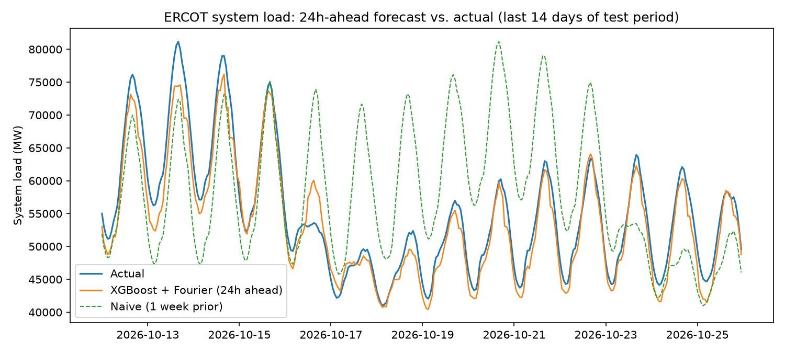
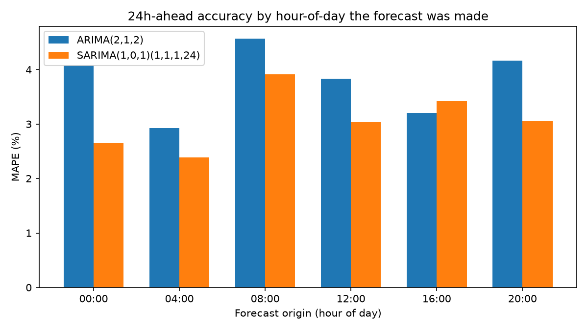
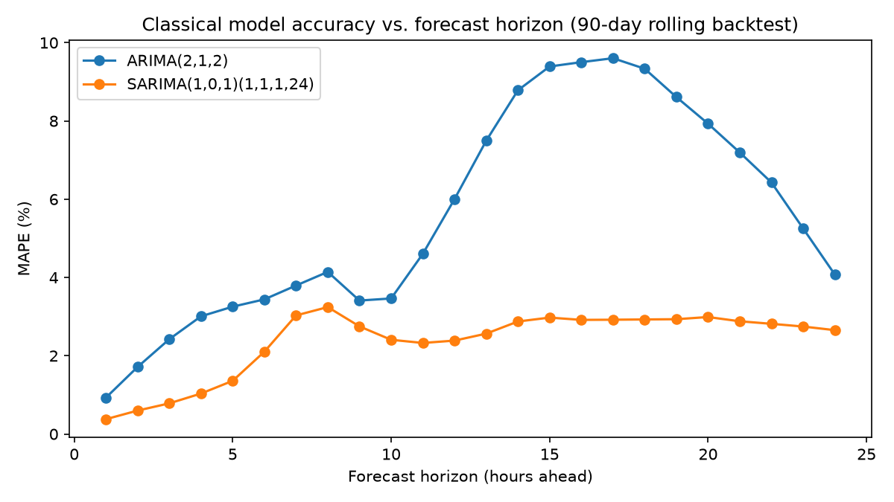

# ERCOT Load Forecast

Short-horizon (24h-ahead) load forecasting for the Texas grid: naive
baseline, ARIMA, SARIMA, and XGBoost, benchmarked against each other on
the same held-out window.

Status: **v2 — XGBoost overtakes SARIMA once it gets per-zone weather.**
Part of [Bat City AI](https://batcityai.com)'s Year One programs.

## Result (most recent run)

Four models, same 90-day held-out test window (Jul 28 – Oct 25, 2026 — a
window that itself spans the transition from summer heat into fall).
ARIMA/SARIMA are backtested from 6 different hours-of-day (00:00, 04:00,
08:00, 12:00, 16:00, 20:00 — 535 origins total), not just one:

| Model | MAPE |
|---|---|
| Naive (1 week prior) | 6.30% |
| ARIMA(2,1,2) | 3.79% |
| SARIMA(1,0,1)(1,1,1,24) | 3.07% |
| **XGBoost + Fourier + 8-zone weather (24h ahead)** | **2.70%** |

**XGBoost now wins outright.** The previous round (v1.1) gave XGBoost
Fourier terms for the daily/weekly cycle and it still lost to SARIMA
(3.45% vs. 3.07%, or 3.35% vs. 3.07% on the exact matched timestamps).
The missing piece turned out to be simpler than a better seasonal
representation: **ERCOT spans multiple climates, and the model only ever
saw Austin's temperature.** `fetch_data.py` now pulls one weather station
per ERCOT weather zone (Houston for Coast, Midland for Far West,
Wichita Falls for North, etc. — 8 zones total) instead of one station for
the whole state. That alone dropped full-test MAPE from 3.45% to 2.70%,
and on the identical matched timestamps SARIMA was evaluated on,
XGBoost now scores 2.65% against SARIMA's 3.07%. The improvement held
in every month, not just one lucky stretch (see table below).

This is the more interesting finding than "model X beats model Y": the
bottleneck wasn't the model architecture, Fourier terms, or anything
clever — it was that the input data didn't represent the geography of the
thing being forecast. Worth remembering before reaching for a fancier
model when a simpler one is underfed.

| Month | XGBoost + Fourier + 8-zone weather | Naive |
|---|---|---|
| 2026-07 | 1.88% | 3.17% |
| 2026-08 | 2.35% | 2.53% |
| 2026-09 | 2.50% | 3.39% |
| 2026-10 | 3.52% | 14.99% |



The monthly breakdown shows the naive baseline is dangerous to trust
blindly: in July and August, when the weather is just "hot," same-hour-
last-week is nearly as good as any model. The gap opens up hard in October
once temperatures start swinging week to week — and even there, XGBoost
with real geography now clearly leads.



### ARIMA vs. SARIMA by month and hour-of-day

Rolling refit on a trailing 21-day window at each origin, forecasting 24
hours ahead (`scripts/compare_classical.py`):

| Month | n origins | ARIMA | SARIMA |
|---|---|---|---|
| 2026-07 | 24 | 2.18% | 1.70% |
| 2026-08 | 186 | 2.44% | 2.31% |
| 2026-09 | 180 | 3.73% | 2.59% |
| 2026-10 | 145 | 5.88% | 4.88% |



SARIMA beats ARIMA at every hour-of-day we tested, but the margin varies —
near-identical at 16:00, widest at 00:00 and 20:00.



This horizon chart is the clearest explanation of *why* SARIMA wins: plain
ARIMA has no way to represent the daily load cycle, so its error balloons
as the horizon stretches toward 12-15 hours out before partially recovering
as the forecast wraps back into phase with a similar time of day. SARIMA's
seasonal term keeps the daily cycle in view the whole time, so its error
climbs far more gently across the full 24-hour horizon.

## How it works

1. `scripts/fetch_data.py` combines ERCOT's static annual
   ["Native Load" archives](https://www.ercot.com/gridinfo/load/load_hist)
   (full years, posted with a settlement lag) with the live "Actual System
   Load by Weather Zone" feed (via [gridstatus](https://github.com/kmax12/gridstatus))
   for the trailing days not yet archived — giving continuous history from
   Jan 2024 through yesterday instead of the ~30 days the live feed alone
   retains. Keeps per-zone load (both sources report it) and pulls
   [Open-Meteo](https://open-meteo.com) historical weather for one city
   per ERCOT weather zone (8 total), not just Austin.
2. `scripts/train_baseline.py` builds lag + calendar + 8-zone-temperature +
   Fourier (daily/weekly sin-cos) features, trains an XGBoost regressor to
   predict load 24 hours out, and compares it to the naive baseline on a
   90-day held-out test window, with a monthly error breakdown and a
   head-to-head against ARIMA/SARIMA on their matched timestamps.
3. `scripts/compare_classical.py` runs a rolling-origin backtest over the
   same 90-day window from 6 different hours-of-day: fit ARIMA and SARIMA
   on the trailing 21 days of actual load, forecast 24 hours ahead, record
   the result, advance one day, repeat — 535 origins total. Also produces
   the horizon-degradation and by-hour-of-day accuracy charts.

## Setup

```bash
python3 -m venv .venv
source .venv/bin/activate
pip install -r requirements.txt

# macOS only — xgboost needs the OpenMP runtime
brew install libomp

python3 scripts/fetch_data.py
python3 scripts/train_baseline.py
python3 scripts/compare_classical.py  # ~20-25 min: 535 ARIMA + SARIMA refits (6 hours-of-day x 90 days)
```

## Known limitations (v3 candidates)

- **SARIMA hasn't gotten the same upgrade.** XGBoost now wins, but SARIMA
  is still univariate — it has never seen temperature at all, let alone
  8 zones of it. A SARIMAX with exogenous weather regressors is the fair
  rematch before concluding gradient boosting is really ahead here.
- **Per-zone *load* (not just temperature) is sitting in the data unused.**
  Both ERCOT sources already report load by zone; `fetch_data.py` keeps
  those columns but `train_baseline.py` doesn't use them as features yet.
- **Still not literally every hour.** 6 of 24 hours-of-day is a much more
  representative classical-model sample than 1, but not exhaustive — a
  full 24-hour sweep would take ~90 minutes of fitting and wasn't run.
- **Classical models use a short, fixed 21-day trailing window**, refit
  daily. Different window sizes or refit cadences weren't swept.
- **Temperature is not a forecast.** The model uses the *actual* recorded
  temperature at the target hour as a stand-in for a weather forecast,
  since this is a historical-data pipeline. A real deployment would need a
  genuine weather forecast feed, which has its own error and would make
  the model's real-world accuracy somewhat worse than shown here.
- **ERCOT archive URLs aren't stable.** The static yearly files are
  hand-coded in `fetch_data.py`; the current year's filename has an
  inconsistent versioning suffix, so the URL list needs occasional manual
  updates.

## Data sources

- ERCOT public load data — [ERCOT MIS](https://www.ercot.com)
  ([hourly load archives](https://www.ercot.com/gridinfo/load/load_hist) +
  live feed via `gridstatus`)
- Weather — [Open-Meteo](https://open-meteo.com) historical archive (free, no key)

## License

MIT
